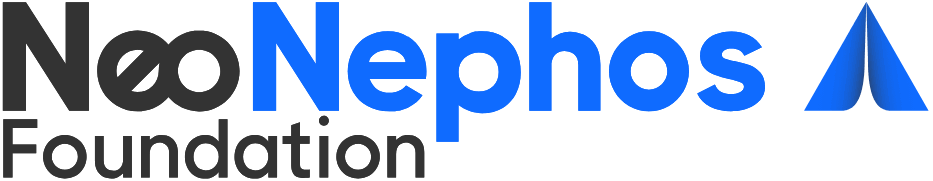

  

    
  

  <h1>Kubernetes Controller and API Federating Telco and Cloud</h1>

  

    
    &nbsp;
    
  

| Attribute | Details |
| :--- | :--- |
| Project | NeoNephos-Katalis |
| Description | Kubernetes Controller and API federating Telco and Cloud |
| License | [Apache 2.0](LICENSE) |
| Documentation | [neonephos-katalis/opg-ewbi-documentation](https://github.com/neonephos-katalis/opg-ewbi-documentation) |
| LFX Insights | [Katalis](https://insights.linuxfoundation.org/project/katalis) |
| Status | Active |

---

## What is Katalis?

Katalis is an open source initiative hosted under the **Linux Foundation Europe Project NeoNephos**. The NeoNephos Foundation focuses on building an open, secure, and interoperable cloud-edge continuum, empowering European stakeholders to collaborate and innovate for Europe's digital infrastructure.

This project is part of the activities carried out within the **Important Project of Common European Interest on Next Generation Cloud Infrastructure and Services (IPCEI-CIS)**, an EU initiative to establish sovereign, interoperable, and energy-efficient cloud-to-edge infrastructure across Europe, in alignment with the [8ra](https://www.8ra.com/ipcei-cis) European research program umbrella.

Inspired by the word "Catalyst", Katalis symbolizes transformation, acceleration, and orchestration across federated Telco and Kubernetes infrastructure.

### Conceptual Acronym

- **K** - Kubernetes (Cloud-native Orchestration)
- **A** - API (Bridging Telco APIs and Cloud Provider APIs)
- **T** - Telecom (Industry Focus)
- **A** - Automation (Seamless and Declarative)
- **L** - Link (Federation and Peering Integration)
- **I** - Interoperability (Unifying Telco and IT Cloud Resource Provisioning)
- **S** - Synchronization (Federated Resource Management)

---

## Architecture and Scope

The Katalis project bridges Telco operator infrastructure and modern Kubernetes cloud platforms, enabling bidirectional integration across the cloud-edge continuum:

- **Edge Consumption:** Facilitates the consumption of Telco operator compute and storage resources from Kubernetes environments (such as Gardener-controlled clusters), allowing application fragments to be placed close to the network edge to satisfy strict latency constraints.
- **Federation Extension:** Extends Telco operator federation across diverse cloud providers and sovereign edge topologies based on the [GSMA Operator Platform](https://www.gsma.com/solutions-and-impact/technologies/networks/operator-platform-hp/) specification.

---

## Organization Repositories

The `neonephos-katalis` GitHub organization coordinates the platform through decoupled, single-responsibility repositories:

| Repository | Description | Primary Role |
| :--- | :--- | :--- |
| [opg-ewbi-operator](https://github.com/neonephos-katalis/opg-ewbi-operator) | Core Kubernetes controller manager and REST API server | Runtime operator reconciling federation custom resources |
| [opg-ewbi-crds](https://github.com/neonephos-katalis/opg-ewbi-crds) | Centralized Custom Resource Definitions and Go API types | Decoupled CRD lifecycle and lightweight Go module imports |
| [opg-ewbi-helms](https://github.com/neonephos-katalis/opg-ewbi-helms) | Centralized production Helm charts catalog | Deployment packaging, linting, and Kind CI verification |
| [opg-ewbi-api](https://github.com/neonephos-katalis/opg-ewbi-api) | GSMA EWBI OpenAPI definitions and client SDKs | API schemas, protocol definitions, and contract testing |
| [opg-ewbi-documentation](https://github.com/neonephos-katalis/opg-ewbi-documentation) | Architecture documentation and specifications | System guides, technical specifications, and user manuals |
| [.github](https://github.com/neonephos-katalis/.github) | Community health files and organization profile | Project charter, governance model, and profile metadata |

---

## Governance

Katalis operates under an open governance model guided by Linux Foundation best practices:

- **Steering Committee (SC):** Responsible for strategic direction, alignment with EU initiatives (such as IPCEI-CIS), and coordination with external open source projects (Gardener, OCM, ApeiroRA).
- **Technical Steering Committee (TSC):** Oversees technical architecture, specification evolution, and cross-repository interoperability. Members are maintainers elected by active contributors.
- **Working Groups (WG):** Specialized topic groups addressing security, cloud-edge federation, and API standardization.
- **Community Contributions:** Contributions are managed through standard Pull Requests and Issues. Technical code merges require review and approval from designated project maintainers.

---

## Principles

1. **Openness:** Participation is open to all community members and industry stakeholders.
2. **Transparency:** Technical discussions, architectural proposals, and governance decisions are documented in public repositories.
3. **Meritocracy:** Project influence and leadership roles are earned through consistent contributions.
4. **Neutrality:** Vendor-neutral architecture focused on open standards and cross-cloud interoperability.
5. **Security by Design:** Strict adherence to European security and data protection regulations (such as GDPR, NIS2, and supply chain hardening).

---

## Decision Making

- **Consensus First:** Working groups seek collaborative agreement on technical decisions.
- **Lazy Consensus:** Uncontested proposals move forward following a standard review period.
- **Escalation Path:** Unresolved technical disputes are escalated to the Technical Steering Committee (TSC), and subsequently to the Steering Committee (SC) when strategic alignment is required.

---

## How to Engage

- **Issues & Discussions:** Report defects, submit feature requests, and discuss proposals within individual project repositories.
- **Pull Requests:** Propose code changes, schema improvements, or documentation updates using the established contribution templates.
- **Working Groups:** Participate in regular community meetings and working sessions.

---

## References and Standards

- [GSMA Operator Platform Group (OPG) Overview](https://www.gsma.com/solutions-and-impact/technologies/networks/operator-platform-hp/)
- [GSMA OPG.02 - Operator Platform: Requirements and Architecture](https://www.gsma.com/solutions-and-impact/technologies/networks/gsma_resources/opg-02-requirements-and-architecture/)
- [GSMA OPG.04 - East/Westbound Interface (EWBI) APIs](https://www.gsma.com/solutions-and-impact/technologies/networks/gsma_resources/opg-04-east-westbound-interface-apis/)
- [GSMA OPG.11 - Operator Platform Requirements for Edge Services](https://www.gsma.com/solutions-and-impact/technologies/networks/gsma_resources/opg-11-operator-platform-requirements-for-edge-services-2/)
- [GSMA OPG.12 - Operator Platform: Requirements for Network as a Service (NaaS)](https://www.gsma.com/solutions-and-impact/technologies/networks/gsma_resources/opg-12-operator-platform-requirements-for-network-as-a-service/)
- [IPCEI-CIS European Cloud Infrastructure Initiative](https://competition-policy.ec.europa.eu/state-aid/ipcei/approved-ipceis/cloud_en)
